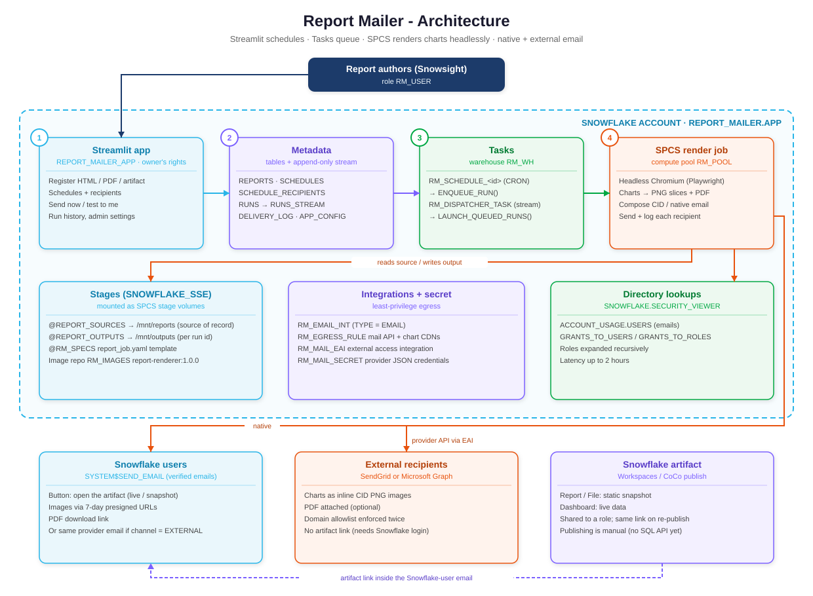
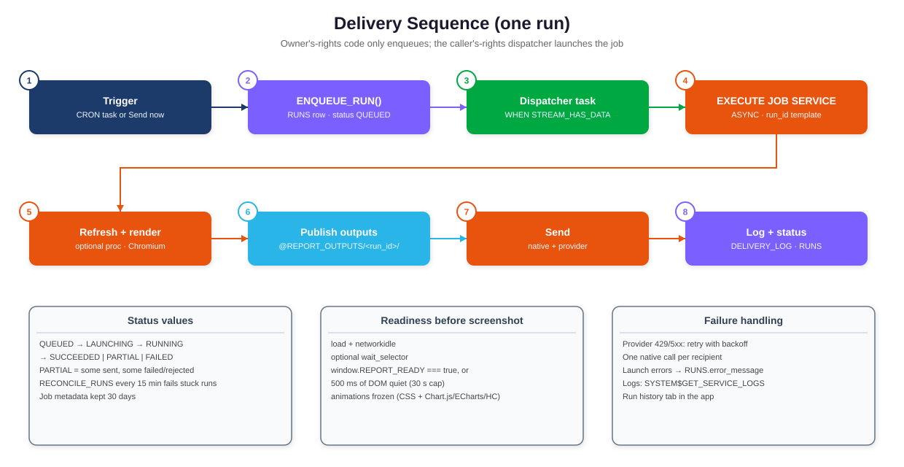
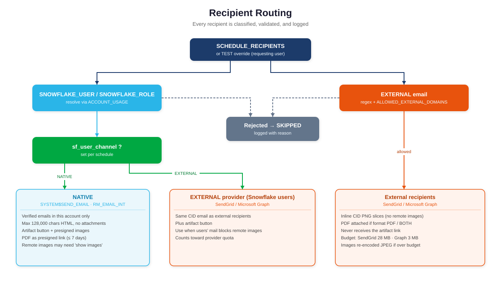

# report-mailer: build spec

This is a Snowflake app that runs in Snowsight. Users register an **HTML**, **PDF** or **Snowflake artifact** report, schedule it, and email it to **Snowflake users** and **non-Snowflake recipients**. HTML reports built with JavaScript charting libraries (Chart.js, Plotly, ECharts, Highcharts, D3, Vega) arrive **fully rendered**, because a headless browser in Snowpark Container Services draws them to images before sending.

> **Status: build spec.** Nothing has been deployed to any Snowflake account. All code, SQL and docs are complete. The renderer was verified locally (see [Verification](#verification)). To deploy, follow [docs/DEPLOYMENT.md](docs/DEPLOYMENT.md).



An HTML overview is also available for slides: [report-mailer-architecture.html](report-mailer-architecture.html).

## Why this design

| Need | How it is met |
|---|---|
| Charts must render in email | Email clients do not run JavaScript. The SPCS job loads the report in Chromium (Playwright 1.64.1), waits for charts to finish, and screenshots them into PNG strips and a PDF. |
| Non-Snowflake recipients | Sent through **SendGrid** or **Microsoft Graph** over an External Access Integration. Images are inline CID attachments, so they show without "load remote images". |
| Snowflake users | Sent through **`SYSTEM$SEND_EMAIL`** (native, no third party). The email includes a button to the **Snowflake artifact**, plus presigned image and PDF links. |
| Artifacts | Artifacts open only after sign-in to the same account, and they have no SQL publish API. So the **stage file is the system of record** for rendering, and the artifact link is added only for Snowflake users. |
| Runs in Snowsight | A Streamlit in Snowflake app (owner's rights) registers reports and schedules, and queues runs. |

### Key design decisions

1. **Streamlit only enqueues work.** Owner's-rights code (Streamlit and owner's-rights procedures) may run only SELECT, DML, DDL, GRANT and SHOW/DESCRIBE. `EXECUTE JOB SERVICE` is not on that list. So the app inserts a row in `RUNS`, and a **triggered task** calls the caller's-rights `LAUNCH_QUEUED_RUNS()`.
2. **One launch path.** Schedule tasks, "Send now" and "Send test to me" all call `ENQUEUE_RUN()`. `RUNS_STREAM` wakes the dispatcher only when there is work.
3. **Stage volumes, not GET/PUT.** The job mounts `@REPORT_SOURCES` at `/mnt/reports` and `@REPORT_OUTPUTS` at `/mnt/outputs`.
4. **No credentials in code.** The job authenticates with the SPCS session token. Mail provider credentials live in `RM_MAIL_SECRET` and are injected as an environment variable.
5. **Defense in depth.** The external domain allowlist and recipient cap are enforced in both the app and the job. Browser network access is restricted to an allowlist that mirrors the network rule. Every recipient is logged.

## Repository layout

```
renderer/            SPCS job: Dockerfile, app/ (render, compose, mailers, db, main), spec/report_job.yaml
sql/                 01_roles_db · 02_tables · 03_procedures · 04_integrations · 05_spcs_and_app · 99_teardown
streamlit/           streamlit_app.py, environment.yml
scripts/             build_push.sh (image), gen_diagrams.py (regenerates docs/images/*.svg)
samples/             sales_weekly/report.html - Chart.js + Plotly test report
tests/               pytest unit tests (no Snowflake or network needed)
docs/                DEPLOYMENT.md, OPERATIONS.md, images/*.svg
```

## How a run works



1. A CRON task `RM_SCHEDULE_<id>`, or a user in the app, calls `ENQUEUE_RUN()`, which creates a `RUNS` row with status `QUEUED`.
2. `RM_DISPATCHER_TASK` fires on `SYSTEM$STREAM_HAS_DATA` and runs `EXECUTE JOB SERVICE … ASYNC = TRUE … USING (run_id => 'R…')`.
3. The job optionally calls the report's refresh procedure, renders the report, and writes the PNG slices and PDF to `@REPORT_OUTPUTS/<run_id>/`.
4. Recipients are resolved: named users, plus members of roles (expanded recursively) via `ACCOUNT_USAGE`. Each recipient is routed as shown below.
5. Every delivery is written to `DELIVERY_LOG`, and the run ends as `SUCCEEDED`, `PARTIAL` or `FAILED`.



## Report authoring contract

- Put the report and its relative assets in one folder on `@REPORT_SOURCES`. The app does this when you upload.
- Charts may load libraries from CDNs listed in `RM_RENDER_ALLOWED_HOSTS` **and** `RM_EGRESS_RULE`. Requests to any other host are blocked and logged.
- **Recommended:** set `window.REPORT_READY = true` after your last chart draws. If the flag is not defined, the renderer instead waits for 500 ms of DOM quiet (30 s cap). An optional `wait_selector` per report adds a further wait.
- Animations are disabled automatically (CSS transitions; Chart.js, ECharts and Highcharts JS animations).
- Data freshness: give a report a `refresh_procedure` (`DB.SCHEMA.PROC`, no arguments). The procedure rewrites the HTML on the stage before each render.

## Verification

| Check | Result |
|---|---|
| Local render of `samples/sales_weekly/report.html` (Playwright 1.64.1, Chromium) | Readiness signal `REPORT_READY`, 0 blocked requests, 2400×2272 px, 2 slices, 375 KB vector PDF. All Chart.js and Plotly charts fully drawn. |
| Email MIME structure | `mixed → alternative(text, related(html + 2 inline PNG)) + PDF`. Every `cid:` reference resolves. |
| Unit tests (`.venv/bin/pytest -q tests`) | 9 passed: recipient split and domain rules, subject injection, HTML escaping, native size fallback, SendGrid and Graph payloads, slicing and size budget, host allowlist. |
| Recipient-resolution SQL | Compiled against real `SNOWFLAKE.ACCOUNT_USAGE` views. |
| Docker image build | **Not run.** Docker Desktop on the build machine requires a sign-in to the `snowflakeinc` organization. The image uses the official `mcr.microsoft.com/playwright/python:v1.64.1-noble-amd64` base, with the same Playwright version as the local test. |
| DDL execution | **Not run** (build-spec scope). Statement syntax follows current Snowflake docs. Run in a sandbox account first ([DEPLOYMENT.md §9](docs/DEPLOYMENT.md#9-validation-checklist)). |

## Known platform limits (designed around)

| Limit | Effect |
|---|---|
| `SYSTEM$SEND_EMAIL`: verified emails of users in the same account only; HTML up to 128,000 characters; no attachments | Snowflake users get presigned image and PDF links. If the HTML is too long, the email switches to link buttons only. |
| Presigned URLs on internal stages: **7 days maximum** | Native-email images and PDFs expire after 7 days. The artifact and the stage outputs remain. |
| Some mail clients block remote images by default | Affects the native channel. Set the schedule's "Snowflake users receive via" to **EXTERNAL** to send CID-embedded images instead. |
| `ACCOUNT_USAGE` latency of up to 2 hours | New users and role grants may take up to 2 hours to appear as recipients. |
| Artifacts: no SQL publish/update API; Report/File artifacts are snapshots; Dashboard artifacts are live | Publishing an artifact stays a manual step in Workspaces or Cortex Code. Re-publishing keeps the same link, so schedules never need editing. |
| Microsoft Graph inline JSON attachments must be under 3 MB | The job re-encodes images to JPEG (quality 85, then 70) to fit, and fails clearly if they still don't. |

See [docs/OPERATIONS.md](docs/OPERATIONS.md) for monitoring, troubleshooting, cost and sizing.
