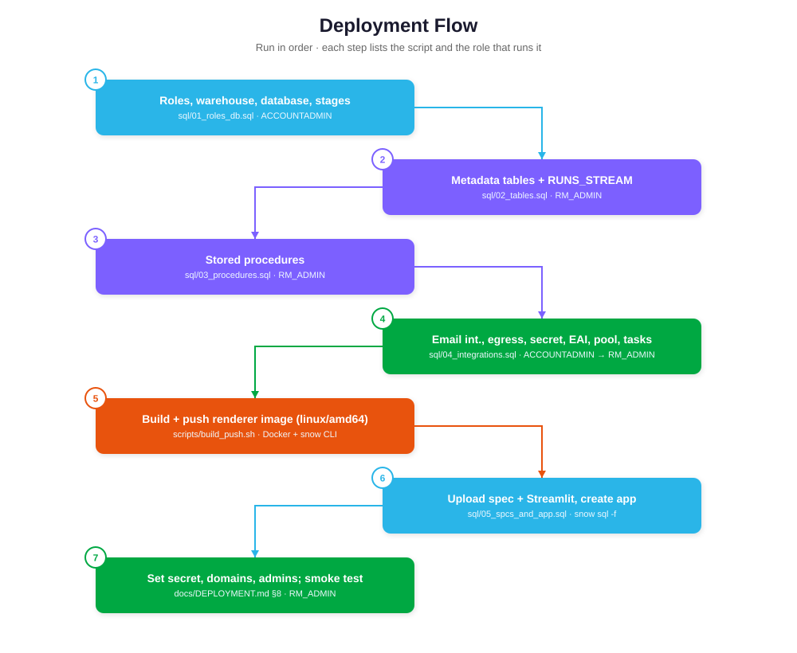

# Deployment guide



Run the steps in order. Every script is idempotent (`IF NOT EXISTS` / `CREATE OR REPLACE`), except the teardown.

## 0. Prerequisites

| Item | Detail |
|---|---|
| Snowflake account | SPCS-enabled region (AWS, Azure or GCP commercial). Enterprise or higher is not required. |
| Roles | `ACCOUNTADMIN` once, for steps 1 and 4. `RM_ADMIN` afterwards. |
| Workstation | Docker Desktop (signed in, if your organization enforces it), Snowflake CLI `snow` 3.x, Python 3.11 (optional, for local tests). |
| Mail provider (for external recipients) | **SendGrid**: an API key with *Mail Send* permission and a verified sender (Single Sender or domain authentication). **Microsoft Graph**: an Entra ID app registration with **Application** permission `Mail.Send` and admin consent, a client secret, and a sender mailbox UPN. Restrict the sender with an Exchange *Application Access Policy*. |
| Snowflake users who receive email | Each needs an email address on their user object, **verified** in Snowsight (*Profile → Email → Verify*). |

## 1. Roles, warehouse, database, stages

```bash
snow sql -f sql/01_roles_db.sql -c <conn>
```
This creates `RM_ADMIN` and `RM_USER`; warehouse `RM_WH` (XS, 60 s auto-suspend); `REPORT_MAILER.APP`; stages `REPORT_SOURCES`, `REPORT_OUTPUTS`, `RM_SPECS` and `RM_APP_CODE` (all `SNOWFLAKE_SSE`); and image repository `RM_IMAGES`. It also grants `SNOWFLAKE.SECURITY_VIEWER` to `RM_ADMIN` so the job can read user emails and role membership.

## 2. Tables and stream

```bash
snow sql -f sql/02_tables.sql -c <conn> --role RM_ADMIN
```

## 3. Procedures

```bash
snow sql -f sql/03_procedures.sql -c <conn> --role RM_ADMIN
```
`ENQUEUE_RUN`, `UPSERT_SCHEDULE_TASK` and `DROP_SCHEDULE_TASK` run with owner's rights and are called from the app. `LAUNCH_QUEUED_RUNS` runs with caller's rights and is called only from the dispatcher task. `RECONCILE_RUNS` runs with owner's rights.

## 4. Integrations, secret, compute pool, tasks

1. Edit `sql/04_integrations.sql`:
   - **Provider egress.** Keep `api.sendgrid.com:443` for SendGrid, or replace it with `graph.microsoft.com:443` and `login.microsoftonline.com:443` for Graph.
   - **Chart CDNs.** List every host your reports load from. Then put the same list in `RM_RENDER_ALLOWED_HOSTS` in `renderer/spec/report_job.yaml`.
   - **Instance family.** `GEN_X64_G2_4` (3 vCPU / 13 GiB, AWS current generation). On Azure or GCP, or if it isn't offered, use `CPU_X64_S` (same size).
2. Run the script as `RM_ADMIN` (step 1 granted it `CREATE INTEGRATION` and `CREATE COMPUTE POOL`):
```bash
snow sql -f sql/04_integrations.sql -c <conn> --role RM_ADMIN
```
3. Set the real credentials. Never commit them.
```sql
-- SendGrid
ALTER SECRET REPORT_MAILER.APP.RM_MAIL_SECRET SET SECRET_STRING =
  '{"api_key":"SG.xxxxx","from_email":"reports@yourco.com","from_name":"Snowflake Reports","reply_to":"bi-team@yourco.com"}';
-- Microsoft Graph
ALTER SECRET REPORT_MAILER.APP.RM_MAIL_SECRET SET SECRET_STRING =
  '{"tenant_id":"<guid>","client_id":"<guid>","client_secret":"<value>","sender_upn":"reports@yourco.com"}';
```
4. If you use Graph, set `RM_MAIL_PROVIDER: MS_GRAPH` in `renderer/spec/report_job.yaml`.

## 5. Build and push the renderer image

```bash
chmod +x scripts/build_push.sh
scripts/build_push.sh <conn> 1.0.0
```
The script looks up the repository URL (`<org>-<acct>.registry.snowflakecomputing.com/report_mailer/app/rm_images`), logs in with `snow spcs image-registry login`, builds `--platform linux/amd64` (SPCS x86 nodes require amd64), pushes the image, and writes the tag into the spec.

If `docker login` cannot use SSO, create a programmatic access token and run `docker login <registry> -u <USER> -p <PAT>`.

If Docker Desktop shows *"Sign in to continue… Membership in the [org] organization is required"*, sign in to Docker Desktop first. The build cannot start until you do.

## 6. Upload the spec and Streamlit, and create the app

```bash
snow sql -f sql/05_spcs_and_app.sql -c <conn> --role RM_ADMIN     # run from the repo root (PUT uses relative paths)
```
This also adds you to `APP_ADMINS` and uploads the sample report to `@REPORT_SOURCES/sales_weekly/`.

## 7. Grant access

```sql
GRANT ROLE RM_USER TO ROLE <analyst_role>;   -- or TO USER <name>
```

## 8. Configure and smoke-test

1. Open **Snowsight → Projects → Streamlit → REPORT_MAILER_APP**.
2. **Admin** tab: set *Allowed external domains* (for example `yourco.com,partner.com`) and the recipient cap.
3. **Reports** tab: register *Sales weekly* with source HTML, folder `sales_weekly` and main file `report.html` (the file was already uploaded in step 6; re-upload it in the form).
4. **Schedules** tab: create a schedule, then use **Send test to me**.
5. **Run history** tab: the run moves `QUEUED → LAUNCHING → RUNNING → SUCCEEDED` within about 1–3 minutes. The first run includes compute pool start-up and an image pull.

## 9. Validation checklist

| Check | Command / expected |
|---|---|
| Tasks started | `SHOW TASKS IN SCHEMA REPORT_MAILER.APP;` shows `RM_DISPATCHER_TASK` and `RM_RECONCILER_TASK` as `started` |
| Image present | `SHOW IMAGES IN IMAGE REPOSITORY REPORT_MAILER.APP.RM_IMAGES;` lists `report-renderer:1.0.0` |
| Spec uploaded | `LIST @REPORT_MAILER.APP.RM_SPECS;` lists `report_job.yaml` |
| Egress | `DESCRIBE INTEGRATION RM_MAIL_EAI;` shows `enabled = true` |
| Job logs | `SELECT SYSTEM$GET_SERVICE_LOGS('REPORT_MAILER.APP.RM_JOB_<run_id>', 0, 'renderer');` |
| Delivery | `SELECT * FROM REPORT_MAILER.APP.DELIVERY_LOG WHERE run_id = '<run_id>';` shows `SENT` |
| External email | Opens with images inline, no "download pictures" prompt, PDF attached |

## Artifacts: one-time setup per report

1. Publish the report as an artifact from Workspaces or Cortex Code (*Save to Artifacts / Publish*).
2. Share it with a role, for example `SALES_REPORT_VIEWERS`. Add Snowflake recipients to that role (`GRANT ROLE …`).
3. Copy the share link into the report's *Artifact link* field, and the role into *Role the artifact is shared with*.
4. Re-publishing updates the artifact in place, with the same link, so schedules never change. Report and File artifacts are snapshots taken at publish time; Dashboard artifacts show live data.

## Upgrades

- **New renderer version:** `scripts/build_push.sh <conn> 1.1.0`, then re-run the `PUT … report_job.yaml` line in `sql/05`. The next run uses the new image.
- **App change:** re-run `sql/05_spcs_and_app.sql`.

## Removal

`snow sql -f sql/99_teardown.sql -c <conn>` permanently drops all objects, outputs and history.
